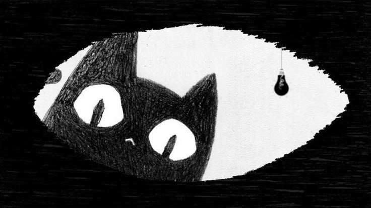

<p align="center">
  
</p>

# SWEEDDIE
### Frontend Developer · UI/UX Designer

# Crafting digital experiences with purpose.

Turning ideas into meaningful digital experiences.

[Email](eddelith@gmail.com) · [GitHub](https://github.com/sweeddie)

---

### ABOUT ME

```ts
const eddie = {
  role: "Frontend Developer & UI/UX",
  focus: [
    "Interface Design",
    "User Experience",
    "Creative Development",
    "Motion Design",
    "Accessibility"
  ],
  stack: ["React", "Next.js", "TypeScript"],
  design: ["Figma", "Design Systems"],
  tools: ["Vite", "Git", "Motion"],
  currentlyLearning: [
    "Advanced TypeScript",
    "Tailwind CSS",
    "GSAP",
    "Component Architecture"
  ],
  philosophy: "Details define experiences."
};
```

### TECH STACK

**FRONTEND**
- React · Next.js · TypeScript
- JavaScript · HTML5 · CSS3
- Vite

**UI / UX & DESIGN**
- Figma · Prototyping
- Design Systems · Responsive Design
- Accessibility · UI Components

**MOTION & INTERACTION**
- Motion · Microinteractions
- GSAP (learning)

**TOOLS**
- Git · GitHub · VS Code

### WHAT I'M EXPLORING

- Building reusable component systems.
- Creating intuitive and accessible interfaces.
- Developing fluid animations and meaningful interactions.
- Exploring modern frontend architecture.

### SELECTED PROJECTS

Projects coming soon.

### LET'S BUILD SOMETHING MEANINGFUL.

Always exploring, designing and building.

`design / develop / refine`
