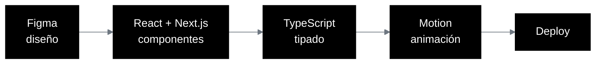

<div align="center">
  
</div>

<br/>

<div align="center">

<h3>Interfaces que se ven bien y se sienten mejor.</h3>

<sub>Frontend Developer · UI/UX · Estudiante de Desarrollo de Software</sub>

<br/><br/>

[](mailto:eddelith@gmail.com)
[](https://github.com/sweeddie)

</div>

<br/>

---

<br/>

<table>
<tr>
<td width="58%" valign="top">

### Sobre mí

```tsx
const eddie = {
  role: "Frontend & UI/UX Developer",
  studying: "Desarrollo de Software",
  stack: ["React", "Next.js", "TypeScript"],
  tools: ["Figma", "Vite", "Motion"],
  focus: ["Interfaces", "Motion", "Accesibilidad"],
  principle: "If it's ugly, it's a bug.",
  status: "Open to collaborate",
} as const;
```

</td>
<td width="42%" align="center" valign="middle">


</td>
</tr>
</table>

<br/>

---

<br/>

### Stack

<table>
<tr>
<td width="22%"><b>Interfaz</b></td>
<td>


</td>
</tr>
<tr>
<td><b>Diseño y motion</b></td>
<td>


</td>
</tr>
<tr>
<td><b>Herramientas</b></td>
<td>


</td>
</tr>
<tr>
<td><b>También</b></td>
<td>


</td>
</tr>
</table>

<br/>

---

<br/>

### Cómo trabajo



<br/>

---

<br/>

### Ahora mismo

```text
construyendo   interfaces con React + Next.js
aprendiendo    TypeScript avanzado y animación con Motion
explorando     design systems y accesibilidad
abierta a      colaboraciones y proyectos de UI
```

<br/>

---

<br/>

### Estadísticas

<div align="center">


<br/>


<br/>


</div>

<br/>

---

<!--
<br/>

### Proyectos destacados

| Proyecto | Qué hace | Stack |
| :-- | :-- | :-- |
| [nombre-del-repo](https://github.com/sweeddie/nombre-del-repo) | Una línea sobre el proyecto | `React` `TypeScript` |

<br/>

---
-->

<br/>

<div align="center">

### ¿Construimos algo?

[](mailto:eddelith@gmail.com)

<br/>

<sub>design · build · ship</sub>


</div>
